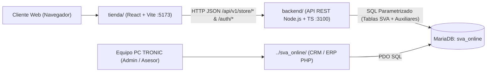
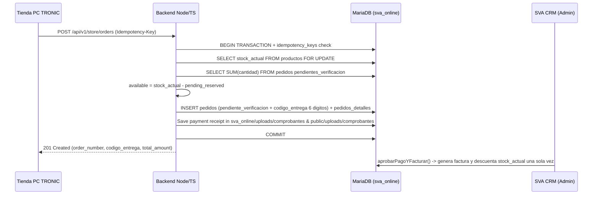

# Arquitectura del Sistema: Tienda Online PC TRONIC + SVA CRM

## 1. Visión General

La solución desacopla la vitrina pública de comercio electrónico (**PC TRONIC**) manteniendo **SVA Online (`../sva_online`)** como sistema central CRM, ERP, inventario, facturación y gestión de pedidos.

- **`tienda/`**: Tienda online pública (React + Vite + TypeScript) especializada en tecnología, computación, periféricos, redes y accesorios de **PC TRONIC** (`RIF: J-41317926-1`).
- **`backend/`**: API REST stateless en Node.js + TypeScript bajo **DDD (Domain-Driven Design)** y arquitectura **Hexagonal (Ports & Adapters)** que actúa como puente seguro entre la tienda pública y la base de datos MariaDB de `sva_online`.
- **`database/`**: Migración SQL incremental (`refresh_tokens`, `idempotency_keys`, `product_search_terms`) compatible con `sva_online`, más seeds opcionales para demo tecnológica.
- **`../sva_online/`**: CRM/ERP existente (PHP MVC) desde donde el equipo administra productos, categorías, precios/tasas BCV, métodos de pago, carrusel de banners y aprobación/despacho de pedidos online.

---

## 2. Bounded Contexts (DDD) en `backend/src/modules/`

Cada módulo se divide en `domain/` (entidades, contratos/ports y reglas puras), `application/` (casos de uso) e `infrastructure/` (adaptadores MariaDB y routers Express con validación Zod):

| Módulo | Tablas SVA / Auxiliares | Responsabilidad |
| :--- | :--- | :--- |
| `health` | `SELECT 1` | Probes `/health/live` y `/health/ready` |
| `auth` | `usuarios`, `clientes`, `refresh_tokens` | Registro de clientes, login (verificación dual Argon2id + bcrypt SVA), JWT + refresh rotativos |
| `catalog` | `categorias`, `productos`, `producto_variantes`, `pedidos_detalles`, `product_search_terms` | Categorías activas, catálogo paginado/filtrable, stock disponible real, búsquedas populares y detalle de producto |
| `banners` | `banners_carrusel` | Carrusel dinámico administrado desde `sva_online` (título, destacado, gradiente, imagen y CTA) |
| `settings` | `configuracion`, `metodos_pago` | Nombre/RIF empresa, tasas BCV/Binance, cuentas de Pago Móvil, Transferencia, Zelle y Binance |
| `sales` | `pedidos`, `pedidos_detalles`, `clientes`, `correlativos`, `idempotency_keys` | Creación idempotente de pedidos web, subida de comprobante hacia `sva_online/uploads/comprobantes` y seguimiento de estado + PIN de entrega |

---

## 3. Sincronización Segura de Inventario y Pedidos (Sin Doble Descuento)

En `sva_online`, la creación de un pedido (`Pedido::create`) registra el pedido en estado `pendiente_verificacion` y el descuento físico de `productos.stock_actual` ocurre cuando el asesor/administrador aprueba el pago (`Pedido::aprobarPagoYFacturar`), momento en el que además se emite la factura formal y se descuenta `productos_depositos`.

Para respetar este ciclo sin provocar sobreventa ni doble descuento:

